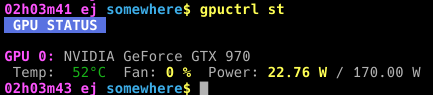
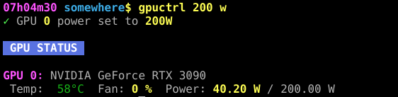
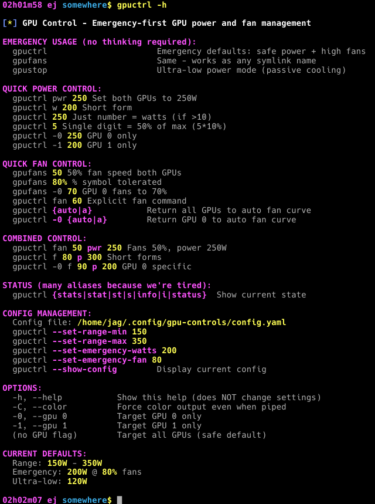
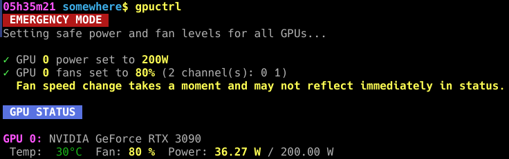
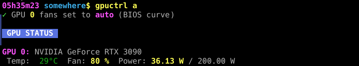

# gpuctrl - RISKY GPU power and fan management

<div align="center">
  <em>Quick Status</em><br>
  <br>
</div>

<div align="center">
  <em>Set Watts Limit</em><br>
  <br>
</div>

## ⚠️ Risk & Responsibility

This tool does what NVIDIA's own software does — it sets fan speeds and power limits through the official driver interface. The GPU's built-in thermal shutdown supposedly still works regardless of what you do here. That said, **overriding fan control is not without risk**, and you should understand what you're taking on:

- If you set fans too low and walk away, your GPU will apparently thermal-throttle and eventually shut the system down. That's the hardware protecting itself — but repeated thermal stress shortens component life.
- This software may have bugs or behave unexpectedly. An update, a driver change, or an unusual system configuration could cause it to malfunction.
- **Running `gpuctrl` with no arguments** puts you in emergency mode: reduced power + high fans. When in doubt, that's the safe move.

The alternatives listed below are more mature, daemon-based tools with automatic fan curves. If you want something that watches your temps continuously without you thinking about it, use one of those instead. This tool is for when you want direct, immediate control.

**Use this software at your own risk.** I wrote it for my own use, I'm sharing it because it might help someone, and I've tried to make the defaults safe — but I can't account for every system configuration, driver version, or edge case.

# Set your defaults:

```bash
$ gpuctrl --set-emergency-watts 150 --set-emergency-fan 70
$ gpuctrl # No args goes into your emergency watts and fan speed
# Default is 200 watts, 80% fan
```

See `-h` help for other settings. They are stored in `~/.config/gpu-controls/config.yaml`

## **Supports symlinks:** gpufans, gpustop

`$ gpufans 80%`

## sudo / root / x11

I don't have a Wayland system to work with. But controlling the GPU settings requires both *root* AND *X11 access*. Thus, we go through some elaborate detection of your X11 session information needed so, when we sudo, we'll "just work". Hopefully.

My GPU was *hot*, but I'd have wanted my fan on higher. However, with my miscellaneous electronics work I.. I don't know. I just like keeping them below "burn my fingers". (I think that's about  ~44°C / 112°F).

I'd be okay with my fan kicking in and speeding up faster. Unfortunately, there apparently isn't a way to just increase the eagerness of the GPU's fan use.

Controlling this through software is *not* ideal. Now, perhaps I'm naive, but I *have* had my system lock up and my GPU continuing. I'd like it if the hardware were not relying on software for this.

Nevertheless, I wanted to set my *max GPU power (watts)*.

<div align="center">
  <em>Overkill convenient CLI controls</em><br>
  <br>
</div>

## Not intended as a replacement / Alternatives:

*It didn't mean anything!*

Okay, this is **not intended** as a replacement for these scripts/daemons that I have no experience with. *[Summaries from Google AI]*:

- [**coolgpus:**](https://github.com/andyljones/coolgpus) A specialized Python tool built specifically for headless Linux servers. It continuously reads your GPU core temperature and applies a linear or piecewise-linear fan curve. You can launch it via a simple terminal command like: `sudo coolgpus --temp 20 55 80 --speed 5 30 99`
- [**gpufanctl:**](https://github.com/gmbeard/gpufanctl) A lightweight background service (daemon) written for Linux. It monitors temperature thresholds in the background and scales fan percentages up or down automatically.
- (**nvfancontrol:**](https://github.com/foucault/nvfancontrol) A high-performance utility written in Rust. It hooks directly into the NVIDIA driver to adjust individual fans dynamically based on precise temperature response curves.

## Emergency Safety Mode

Running `gpuctrl` without args will go into an "emergency" low-power high-fan mode.

<div align="center">
  <em>Set Watts Limit</em><br>
  <br>
</div>

## Switch to NVidia's Auto / Defaults:

<div align="center">
  <em>Go back to GPU's defaults</em><br>
  <br>
</div>
